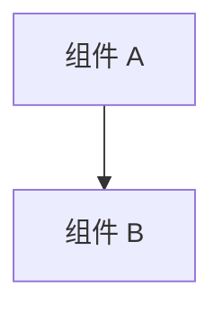
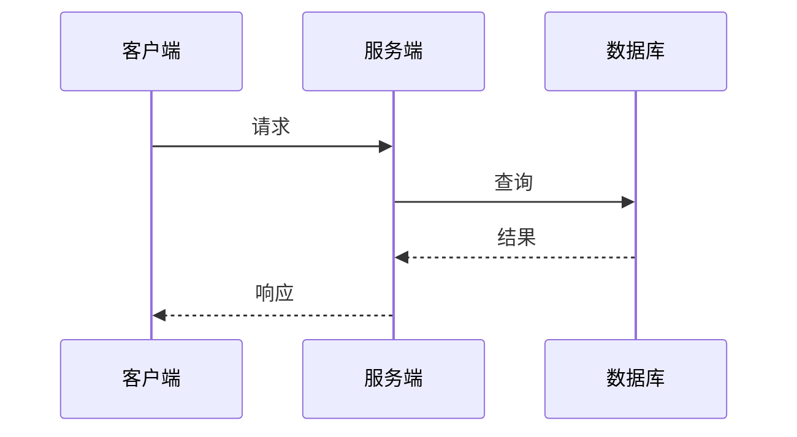
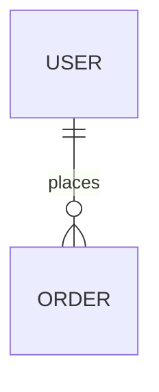

# <项目名> 架构设计

> 读者：开发工程师、测试工程师、安全工程师、技术文档工程师
> 状态：草案
> 更新：YYYY-MM-DD

## 1. 系统上下文（C4 L1）

<一句话结论：系统边界和外部依赖是什么>

## 2. 组件划分（C4 L2）

## 3. 各端架构

### 3.1 移动端 / 前端

- 技术选型与理由：
- 目录结构：
- 状态管理与数据流：

### 3.2 后端

- 服务划分：
- 关键依赖：
- 并发模型：

### 3.3 数据库

- 选型与理由：
- 读写模式：
- 迁移策略：

### 3.4 网络与部署

- 拓扑与区域：
- 入口、负载均衡、网络隔离：

## 4. 关键链路时序

## 5. 数据模型

## 6. 接口契约

| 契约 | 位置 | 提供方 | 消费方 | 状态 |
|---|---|---|---|---|
| | api/xxx.yaml | | | 草案 / 冻结 |

## 7. 模块划分与并行边界

| 模块 | Owner | 输入 | 产出 | 依赖 | 可并行 |
|---|---|---|---|---|---|
| | | | | | |

## 8. 非功能设计

| 维度 | 设计 | 验证方式 |
|---|---|---|
| 性能 | | |
| 容灾与降级 | | |
| 可观测性 | | |
| 成本 | | |

## 9. 技术选型与 ADR 索引

| 决策 | ADR |
|---|---|
| | adr/ADR-001.md |

## 10. 技术债与演进

| 债务 | 影响 | 计划 |
|---|---|---|
| | | |

## 11. 待确认

| # | 问题 | 选项 | 建议 | 决定 |
|---|---|---|---|---|
| | | | | |
