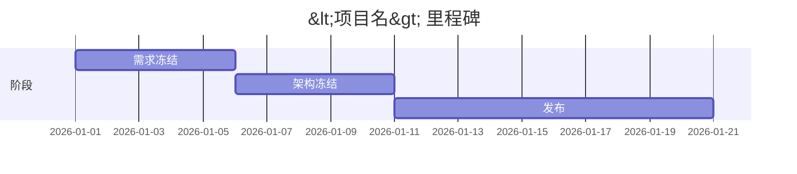

# <项目名> 项目章程

> 读者：全体角色、用户
> 状态：草案
> 更新：YYYY-MM-DD

## 1. 一句话目标

<做什么，为谁解决什么问题>

## 2. 成功标准

- <可验证的标准，带数字>
- <可验证的标准>

## 3. 范围

### 3.1 做

- <能力或功能>

### 3.2 不做（Non-goals）

- <明确排除的事>

## 4. 约束

| 类型 | 约束 |
|---|---|
| 时间 | <截止日期或工期> |
| 资源 | <人力、预算、环境> |
| 合规 | <适用的法规或内部规范> |
| 技术 | <必须使用或禁止使用的技术> |

## 5. 里程碑

| 里程碑 | 进入条件 | 退出条件 | 日期 |
|---|---|---|---|
| | | | |

## 6. 主要风险

| 风险 | 影响 | 概率 | 应对 | Owner |
|---|---|---|---|---|
| | | | | |

## 7. 决策记录

| 日期 | 决策 | 理由 | 决定人 |
|---|---|---|---|
| | | | |
