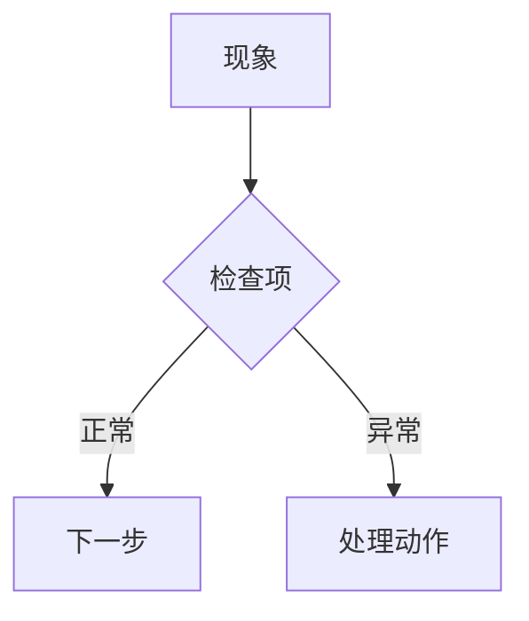

# <项目名> 交付手册

> 读者：使用者、运维、后续维护者
> 状态：草案
> 更新：YYYY-MM-DD

手册写给没参与项目的人。每条命令可以直接复制，每个步骤都要在干净环境验证过。

## 0. 快速开始

<5 分钟内能跑起来的最小步骤：环境要求 → 一条命令 → 验证方式>

## 1. 项目介绍

### 1.1 解决什么问题

<一句话说明，不要用 marketing 语言>

### 1.2 功能清单

| 功能 | 说明 | 入口 | 限制 |
|---|---|---|---|
| | | | |

### 1.3 系统边界与限制

- 不做的事：
- 已知限制：
- 依赖的外部服务：

## 2. 架构概览


<一句话结论：系统由哪几块组成，请求怎么走>

| 组件 | 职责 | 技术栈 | 部署位置 |
|---|---|---|---|
| | | | |

## 3. 环境要求

| 项 | 版本 | 说明 |
|---|---|---|
| 操作系统 | | |
| 运行时 | | |
| 数据库 | | |
| 网络与端口 | | |

## 4. 安装与配置

### 4.1 安装步骤

```bash
# 逐步命令，可直接复制
```

### 4.2 配置项

| 配置 | 必填 | 默认值 | 说明 | 敏感 |
|---|---|---|---|---|
| | | | | 是 / 否 |

敏感配置用环境变量或密钥管理，不要写进配置文件。

## 5. 使用指南

<按用户任务组织。每个任务：前提、步骤、结果、出错怎么办>

## 6. 手工测试流程

| 步骤 | 操作 | 预期结果 | 失败时 |
|---|---|---|---|
| 1 | | | |

- 测试数据准备：
- 环境清理：

## 7. 部署流程

### 7.1 部署前检查

- [ ] 配置齐全
- [ ] 依赖服务可用
- [ ] 备份完成
- [ ] 回滚包就绪

### 7.2 部署步骤

```bash
# 逐步命令
```

### 7.3 部署后验证

| 检查项 | 方式 | 预期 |
|---|---|---|
| 健康检查 | | |
| 核心流程 | | |
| 日志 | | |

## 8. 升级与回滚

| 场景 | 步骤 | 验证 | 回滚 |
|---|---|---|---|
| 版本升级 | | | |
| 数据迁移 | | | |
| 失败回滚 | | | |

## 9. 排障

### 9.1 排障决策树



### 9.2 常见问题

| 现象 | 可能原因 | 排查步骤 | 解决 |
|---|---|---|---|
| | | | |

### 9.3 日志与指标

| 项 | 位置 | 说明 |
|---|---|---|
| 应用日志 | | |
| 访问日志 | | |
| 监控指标 | | |

## 10. 术语表

| 术语 | 含义 |
|---|---|
| | |

## 11. 变更记录

| 版本 | 日期 | 变更 | 作者 |
|---|---|---|---|
| | | | |
