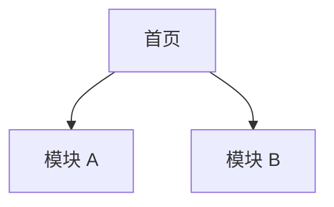

# <项目名> 交互规范

> 读者：开发工程师、测试工程师、产品经理
> 状态：草案
> 更新：YYYY-MM-DD

## 1. 信息架构

## 2. 页面清单

| 页面 | 目标 | 入口 | 状态数 | 原型 |
|---|---|---|---|---|
| | | | | prototype/xxx.html |

## 3. 关键任务流

<每步：用户动作、系统反馈、可退出方式、失败处理>

## 4. 页面状态矩阵（必填）

| 页面 | 默认 | 加载 | 空 | 错误 | 无权限 | 超长文本 | 小屏 |
|---|---|---|---|---|---|---|---|
| | | | | | | | |

## 5. 组件清单

| 组件 | 用途 | 变体 | 状态 | 是否入设计系统 |
|---|---|---|---|---|
| | | | | |

## 6. 视觉规范

| token | 值 | 用途 |
|---|---|---|
| color.primary | | |
| font.size.body | | |
| spacing.md | | |

完整 token 见 `docs/02-design/tokens.json`。

## 7. 可访问性

- 对比度：<标准>
- 键盘操作：<范围>
- 屏幕阅读器：<标注要求>
- 中文排版：<字号、行高、中英混排规则>

## 8. 待确认

| # | 问题 | 选项 | 建议 | 决定 |
|---|---|---|---|---|
| | | | | |
