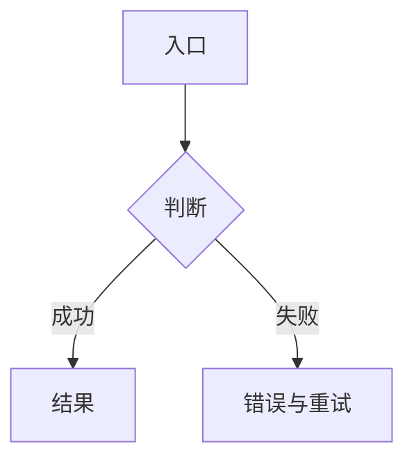

# <项目名> 产品需求文档

> 读者：交互设计师、架构师、测试工程师、项目经理
> 状态：草案
> 更新：YYYY-MM-DD

## 1. 背景与问题

<现状、痛点、为什么现在做>

## 2. 目标用户与场景

| 用户 | 场景 | 现在怎么做 | 痛点 |
|---|---|---|---|
| | | | |

## 3. 功能清单

| ID | 功能 | 优先级 | 验收标准 | 依赖 |
|---|---|---|---|---|
| F-001 | | P0 | | |

## 4. 用户流程

## 5. 非功能需求

| 类别 | 指标 | 测量方式 |
|---|---|---|
| 性能 | P95 延迟 < X ms | |
| 可用性 | 99.X% | |
| 兼容性 | <端与版本> | |
| 合规 | <要求> | |

## 6. Non-goals

- <这版不做的事>

## 7. 依赖与假设

| 类型 | 内容 | 验证方式 |
|---|---|---|
| | | |

## 8. 指标与埋点

| 指标 | 定义 | 事件 |
|---|---|---|
| | | |

## 9. 待确认

| # | 问题 | 选项 | 建议 | 决定 |
|---|---|---|---|---|
| | | | | |
