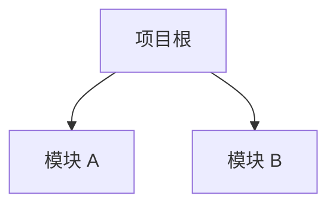

# <项目名> 现状盘点

> 读者：全体角色、用户
> 状态：草案
> 更新：YYYY-MM-DD

盘点已有项目，目的是让角色在动手前理解现状。不要求把项目改造成本 skill 的样子。

## 1. 项目概况

- 做什么：
- 技术栈：
- 代码规模：
- 当前分支 / 版本：
- 维护者（如有）：

## 2. 构建与运行

| 操作 | 命令 | 是否跑通 | 备注 |
|---|---|---|---|
| 安装依赖 | | | |
| 本地启动 | | | |
| 构建 | | | |
| 单元测试 | | | |
| 集成 / E2E | | | |
| 静态检查 | | | |

没跑通的命令要写清卡在哪，不要写「应该可以」。

## 3. 目录与模块

| 模块 | 路径 | 职责 | 维护者 |
|---|---|---|---|
| | | | |

实际边界和文档描述不一致的地方单独列出。

## 4. 现有文档

| 文档 | 路径 | 可信度 | 备注 |
|---|---|---|---|
| | | 准确 / 部分过期 / 已废弃 | |

## 5. 测试现状

| 类型 | 有没有 | 怎么跑 | 当前结果 | 覆盖情况 |
|---|---|---|---|---|
| 单元 | | | 绿 / 红 / 跑不起来 | |
| 集成 | | | | |
| E2E | | | | |

本来就红的测试要单独列出来，后续不能算成这次改动引入的。

## 6. 部署与环境

| 项 | 说明 |
|---|---|
| 部署方式 | |
| 环境（开发 / 测试 / 生产） | |
| 配置与密钥管理 | |
| 监控与日志 | |

## 7. 技术债与风险

| 项 | 位置 | 影响 | 建议处理时机 |
|---|---|---|---|
| | | | |

## 8. 与本 skill 规范的差距

| 项 | 现状 | 本次是否处理 | 说明 |
|---|---|---|---|
| 文档结构 | | | |
| 测试 | | | |
| 安全 | | | |

差距不等于必须改。本次只处理与变更相关的部分，其余记入技术债。

## 9. 文档根约定

- 本次使用的文档根：`docs/` 或 `docs/dev-team/`
- 选择理由：
- 明确不动的现有目录：

## 10. 待确认

| # | 问题 | 选项 | 建议 | 决定 |
|---|---|---|---|---|
| | | | | |
