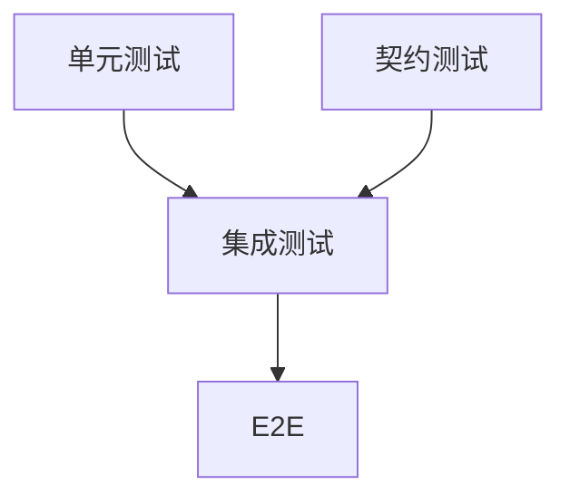

# 测试计划

> 读者：测试工程师、开发工程师、项目经理、产品经理
> 状态：草案
> 更新：YYYY-MM-DD

## 1. 范围与风险

| 范围 | 风险等级 | 测试深度 |
|---|---|---|
| | 高 / 中 / 低 | |

## 2. 分层策略

## 3. 环境与数据

| 项 | 说明 |
|---|---|
| 环境 | |
| 测试数据 | |
| 依赖服务 | |

## 4. 用例设计

| 用例 ID | 需求 ID | 类型 | 前置 | 步骤 | 期望 | 优先级 |
|---|---|---|---|---|---|---|
| TC-001 | F-001 | 正常 / 边界 / 异常 / 并发 / 权限 | | | | |

## 5. 追溯矩阵

| 需求 | 用例 | 类型 | 状态 |
|---|---|---|---|
| | | | 未覆盖 / 通过 / 失败 |

## 6. 入口与出口

- 进入测试：<条件>
- 测试通过：<条件>
- 发布放行：<条件>

## 7. 进度与依赖

| 任务 | Owner | 依赖 | 计划 |
|---|---|---|---|
| | | | |
