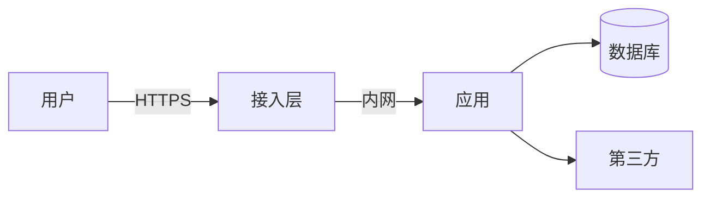

# <项目名> 威胁模型

> 读者：架构师、安全工程师、开发工程师、评审者
> 状态：草案
> 更新：YYYY-MM-DD

## 1. 资产

| 资产 | 敏感级别 | 存放位置 | 谁能访问 |
|---|---|---|---|
| | | | |

## 2. 信任边界与数据流

<一句话结论：边界在哪，数据跨几次边界>

## 3. 攻击面

| 入口 | 暴露范围 | 认证方式 | 潜在攻击 |
|---|---|---|---|
| | | | |

## 4. 威胁清单

| ID | STRIDE 类别 | 威胁 | 路径 | 影响 | 等级 | 对策 | 状态 |
|---|---|---|---|---|---|---|---|
| T-001 | Spoofing | | | | 高 / 中 / 低 | | |

## 5. 安全需求

- 认证：
- 授权：
- 加密：
- 审计与日志：
- 数据留存与删除：

## 6. 待确认

| # | 问题 | 选项 | 建议 | 决定 |
|---|---|---|---|---|
| | | | | |
